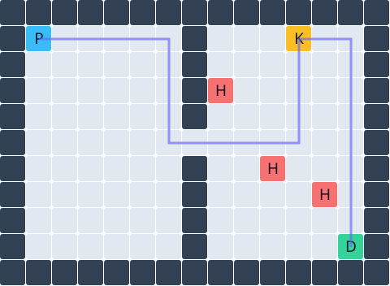

# AgenticPCG Demo

[](https://github.com/JiangZehua/AgenticPCG-Demo/actions/workflows/checks.yml)

**Generate, verify, and play Unity levels with a tool-using agent.**

AgenticPCG Demo turns a design request into a playable 2D key-door maze. The agent edits a structured map; an independent harness checks each candidate, rejects invalid or worse edits, and optionally verifies the route with Unity physics before saving it. The running game can request a revision and load the verified result.



Blue is the player, yellow the key, green the exit, and red a lethal hazard. The purple route visits the key before the exit. This bundled example has 28 route steps and left/middle/right hazard counts of `0 / 1 / 2`.

## What is included

- A playable Unity scene with keyboard movement, walls, key pickup, a locked exit, and lethal hazards.
- An in-game prompt and JSON panel with explicit route-length and hazard controls.
- Bounded Portkey tool calling with candidate validation, rollback, and evaluator-controlled stopping.
- Offline BFS evaluation and an optional isolated Unity Physics2D replay.
- Inspectable JSON maps, candidate traces, evaluation summaries, and SVG previews.
- A deterministic offline demo and automated Python checks with no runtime dependencies.

This is a source demo at version `0.1.0`. Offline behavior is reproducible without credentials. Editor physics and model-backed workflows have prior local validation; a standalone application has not been validated for distribution. See [validation](docs/validation.md) and the [release checklist](docs/release.md).

## Quick start

Requires Python **3.10+**. Run from the repository root:

```bash
git clone https://github.com/JiangZehua/AgenticPCG-Demo.git
cd AgenticPCG-Demo
python3 -m unity_pcg demo --output runs/demo
python3 -m unittest discover -s tests -v
```

The scripted demo rejects an invalid player deletion, repairs a sealed passage, then rejects a regression. It makes no model calls. Open `runs/demo/level.svg` and inspect `summary.json`, `trace.jsonl`, `candidate_*.json`, and `final_level.json`. Each run needs a new or empty output directory.

To install the CLI:

```bash
python3 -m venv .venv
source .venv/bin/activate
python -m pip install -e .
unity-pcg demo --output runs/installed-demo
```

On Windows, activate with `.venv\Scripts\activate` and use `python` where appropriate.

## Play in Unity

1. Install **Unity 6000.6.5f1**, the version recorded in `unity/ProjectSettings/ProjectVersion.txt`.
2. In Unity Hub, add the **`unity/` subdirectory** as the project and allow the import to finish.
3. Open **Assets/Scenes/Demo.unity** and press **Play**.
4. Click the map or hide the generation panel; move with **WASD or arrow keys**, collect the key, and reach the exit. Avoid hazards. Stop and restart Play to reset the embedded map.

Playing the embedded map requires no Python process or API credentials.

For physics verification, keep this project open in the Editor and run from the repository root:

```bash
python3 -m unity_pcg demo --backend unity --output runs/unity-demo
```

Use **Agentic PCG → Import Level JSON for Play** to load `runs/unity-demo/final_level.json` into a generated scene. Keep `UNITY_EDITOR_PATH` blank when using the open Editor. If scripts changed outside Unity, refresh assets and wait for compilation before running.

## Configure model generation

```bash
cp .env.example .env
```

Set `PORTKEY_API_KEY`, `PORTKEY_BASE_URL`, and `PORTKEY_MODEL` for your own tool-calling model route. The base URL must include its API version path, for example `https://your-gateway.example/v1`. Optional virtual-key and config routing fields are documented in `.env.example`. There is no organization-specific default route.

```bash
python3 -m unity_pcg generate \
  --request "Connect the player to the key and exit; keep three hazard zones." \
  --targets unity_pcg/examples/targets.json \
  --max-steps 4 --max-tokens 2048 --output runs/generated
```

Add `--backend unity` to require physics verification. Calls and output tokens are bounded; HTTP failures do not trigger automatic retries. Cost remains `null` unless per-million token prices are configured.

### Generate from the game

In Play mode, set an instruction and numeric controls, then choose **Generate + verify + load**. Unity starts a local Python worker and processes its physics jobs. Only a successful verified result replaces the displayed map. Failed requests, unmet targets, and cancellation retain it.

**Interpret targets** makes one separate model call to extract explicit numeric goals. Review the resulting controls before generation. Alternatively, set the controls directly or paste a request into the JSON tab and choose **Load JSON targets** without a model call. Shortcuts: **Ctrl/Cmd+Enter** prepares targets; **Ctrl/Cmd+Shift+Enter** generates.

The panel's **Local Python settings** selects the repository folder and Python executable. Generation requires a local desktop Python process and this checkout. Standalone generation packaging is untested; WebGL cannot start this worker.

## Request contract

Only the `keydoor` domain is supported:

```json
{
  "schema_version": 1,
  "domain": "keydoor",
  "instruction": "Create a winding route; keep the key before the exit.",
  "targets": {
    "min_path_length": 32,
    "max_path_length": 45,
    "hazard_count": 3,
    "zone_hazards": [0, 1, 2]
  }
}
```

Numeric targets are the executable contract; prose supplies design context. Hazard controls are optional. If both total and zone counts are supplied, they must agree. Unknown fields and contradictory targets are rejected. Hazard placement is a metric, not a measured difficulty curve; style compliance is not automatically certified.

Save the object as `request.json`, then run:

```bash
python3 -m unity_pcg prepare-request --request-file request.json --output runs/prepared.json
python3 -m unity_pcg generate --request-file request.json --revise \
  --backend unity --max-steps 4 --output runs/request-generation
```

`--revise` requests a proposal even if the starting map already meets the targets. `prepare-request --interpret` optionally adds a model interpretation call; its output wraps the normalized request under `request`. To generate from interpreted targets, save that nested object as a new request file.

Return codes: `0` targets verified, `2` completed with unmet targets, `1` configuration or execution error.

## Project structure

| Path | Responsibility |
| --- | --- |
| `unity_pcg/level.py` | Versioned map format, validation, targets, BFS metrics |
| `unity_pcg/tools.py` | Allowlisted edit tools and atomic transactions |
| `unity_pcg/harness.py` | Candidate acceptance, feedback, stopping, artifacts |
| `unity_pcg/provider.py` | Portkey REST client and local environment loading |
| `unity_pcg/bridge.py` | Atomic file jobs, matching reports, timeouts, batch launcher |
| `unity/Assets/AgenticPCG/Runtime/` | Playable map, generation panel, physics replay |
| `unity/Assets/AgenticPCG/Editor/` | Editor bridge and import/build menus |
| `tests/` | Offline integration and boundary checks |
| `docs/` | Architecture, validation, release criteria, delivery backlog |

See [CONTRIBUTING.md](CONTRIBUTING.md) for development and handoff expectations, [delivery backlog](docs/roadmap.md) for remaining release work, and [architecture](docs/architecture.md) for contracts and engine boundaries.

## Related work and attribution

This application builds on [Local-Deployable-AgenticPCG](https://github.com/JiangZehua/Local-Deployable-AgenticPCG) and [AgenticPCG](https://github.com/JiangZehua/AgenticPCG). It uses an independent harness and a Unity execution layer. It does not reproduce their research benchmarks. [CITATION.cff](CITATION.cff) records the related papers.

The code is MIT licensed. Reused benchmark sprites have separate [provenance and licensing notes](docs/architecture.md#sprite-provenance); per-file licensing confirmation remains a packaged-release gate.
