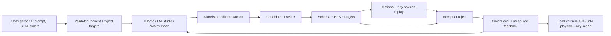

# Architecture and provenance



## Design and related work

This demo implements an independent harness inspired by AgenticPCG: bounded tool use, separate candidate and saved state, evaluator-controlled stopping, and inspectable feedback. Python owns verification and model calls; Unity owns rendering, movement, and engine execution. The two predecessors are linked in the README and CITATION file.

The export adapter preserves the earlier Zelda tile mapping `# . P K D E`, converting `E` into a stationary lethal hazard `H`. It preserves grid geometry and requires a closed boundary with exactly one player, key, and door. No simulator equivalence or inherited benchmark score is claimed.

```bash
python3 -m unity_pcg export-grid previous-level.txt --output runs/imported.json
python3 -m unity_pcg evaluate --level runs/imported.json --backend unity --output runs/imported-evaluation
```

Override `--targets` when an imported level needs different numerical goals.

## Contracts

- Level IR: `schema_version: 1`, rectangular `rows`, size 5–64 in each dimension, closed wall boundary, one `P`, `K`, `D`. Coordinates are zero indexed with `y` downwards; Unity maps `(x,y)` to `(x,-y)`.
- Reachability: `P→K` cannot cross the locked door, walls or hazards; `K→D` may enter the door. Route length counts cardinal steps, not unique cells. BFS supplies a route witness, not a proof of all runtime behaviors.
- Hazard zones: three vertical thirds of the **interior**, with zone index `min(2, floor((x-1)*3/(width-2)))`. Counts are a static placement proxy; they are not an empirically calibrated difficulty metric.
- Actions: 1–8 calls per transaction; allowlisted names, exact argument keys, bounded integer coordinates, and known tile strings. A failed action invalidates the entire transaction. `fill_rect` and `carve_corridor` preserve entities. `set_tile` moves an entity by clearing its old position, then whole-level validation runs.
- Acceptance: lexicographic `[unreachable route legs, target error]`, lower is better; nonworsening changed maps can be saved. Invalid/no-op/worse candidates are rejected. In Unity mode, geometrically feasible candidates also need an engine win before commitment. This greedy rule can trap on plateaus; a future search experiment should change and version the policy explicitly.
- Stopping: only when the saved map satisfies the contract and, if enabled, has a successful corresponding physics report. Model `finish` calls cannot override this.

## Model boundary

`ModelClient` selects an explicit provider/model through CLI options or repository configuration. Ollama and LM Studio use their local OpenAI-compatible Chat Completions endpoints; Portkey remains an optional gateway. One parser normalizes structured tool calls and usage metadata for the existing harness. Each request records provider/model provenance. Local responses lacking valid calls consume a bounded failed step; plain text is never executed.

Provider-specific authentication stays in Python. Local calls never receive Portkey headers; optional local tokens use Bearer authentication. There is no automatic cloud fallback or retry. Both target interpretation and map generation use this client, including workers launched by Unity. See [provider configuration](providers.md).

## Engine boundary

Python writes an atomic job to `.bridge/jobs/<uuid>.json`, containing the level, BFS route, request ID and digest. The shared `BridgeFiles` handler consumes one job at a time. In Edit mode, `AgenticBridge` polls and `PhysicsReplay` creates a temporary preview scene through `EditorSceneManager.NewPreviewScene`. During Play, `GenerationPanel.Update` polls and replay uses `SceneManager.CreateScene` with local Physics2D. It reserves a user layer unused by all loaded 2D colliders/rigidbodies, enables only that layer's self-collisions, and limits simulation to that layer's bodies/contacts. It closes the temporary scene and restores the collision mask and active scene in `finally`, then atomically writes a matching report. Runtime `SceneManager.CreateScene` with local physics parameters cannot be used in Edit mode. Python matches the ID/digest, bounds waits, and removes timed-out jobs. Batch mode uses the same handler; per-candidate startup is slower but keeps the interface small.

The physics runner uses the same `LevelBuilder` and `PlayerMotor` as manual play. It advances a fixed 0.02-second step and observes generated collider contacts. Route points must be adjacent and visit the key before the door. Reported simulated time differs from wall-clock evaluation time. The report includes Unity version, step count, key/door outcome, and failure location.

The report identifies **Edit mode or runtime physics replay**. It does not measure rendering FPS, exercise `Start`/`Update` scheduling through a complete Play Mode session, certify a standalone build, or test alternate player policies. Runtime replay advances an isolated simulation while the game runs; human play and a built application remain separate release gates. See [Unity's simulation behavior](https://docs.unity3d.com/6000.0/Documentation/ScriptReference/Physics2D.Simulate.html).

## Runtime input and commitment

`GenerationPanel` serializes an instruction and numeric controls into `.bridge/requests/<uuid>/input.json`, then starts `python -m unity_pcg` with redirected output. It uses `ProcessStartInfo` without a shell; prompt text is in JSON, not command arguments. The optional `prepare-request --interpret` call asks for one `set_targets` tool response and validates it; the user reviews the controls before generation. JSON preparation without interpretation is deterministic and has no model call.

The request contract has exact fields `schema_version`, `domain`, `instruction`, `targets`; only `keydoor` is accepted. Python owns candidate acceptance and `.env`. Unity owns display and actual physics execution. The UI loads `final_level.json` only when the child exits successfully and `summary.json` reports satisfied targets and an engine win. Partial improvements can remain in run artifacts while the visible map stays unchanged. Cancellation kills the worker and removes only jobs with its `owner_pid`. A fresh generation starts from the displayed map, not the original sample.

Numerical targets are executable constraints; free-form style is design context. `--revise` allows one proposal even when the starting map already meets numeric goals. This does not introduce a visual quality judge: a changed nonworsening map can be saved, but style compliance is not certified. Adding a domain requires its IR semantics, tools, metrics/evaluator and Unity builder/controller, then a matching input panel.

## Sprite provenance

`unity/Assets/AgenticPCG/Resources/Keydoor/{empty,solid,player,key,door,bat}.png` are unmodified copies of `vendor/pcg_benchmark/probs/zelda/images/` in Local-Deployable-AgenticPCG. The vendor source is [JiangZehua/pcg_benchmark](https://github.com/JiangZehua/pcg_benchmark), forked from [Ahmed Khalifa’s PCG Benchmark](https://github.com/amidos2006/pcg_benchmark). Its README credits [Kenney’s 1-Bit Pack](https://kenney.nl/assets/1-bit-pack) for many sprites and inspiration; Kenney labels that pack CC0. The benchmark does not identify each of these six files’ authors separately, so this attribution does not assert a per-file CC0 license or ownership. Confirm asset-specific licensing before a packaged public release; the repository’s MIT license covers this project’s code.

PNG import uses 16 pixels per Unity unit, Point filtering and no mipmaps. `LevelBuilder` loads these sprites from Resources for visible maps, draws floor below entity sprites, and uses explicit collider dimensions independent of art. The player still occupies a 0.6-unit collision box and moves continuously with Rigidbody2D; the map and path metrics remain a discrete cardinal grid. The bat represents a stationary hazard, not an enemy AI. Physics-only replay loads no sprites.

## Tradeoffs

Standard-library REST and local file RPC avoid SDK/MCP/server dependencies in this demo. A single game domain avoids importing the research framework's full dependency stack. JSON embedded in a scene gives standalone builds a simple asset path. There is no persistent agent memory, dynamic C# generation, general scene editing, multi-agent orchestration, renderer judge, or platformer physics yet; add each when a measured task requires it.

Credentials are loaded only by Python. Job files and generated scenes contain no provider credentials. Trace includes tool arguments, metrics and decisions, not HTTP headers or raw gateway error bodies. An operator controls gateway endpoints and routing through local configuration.
